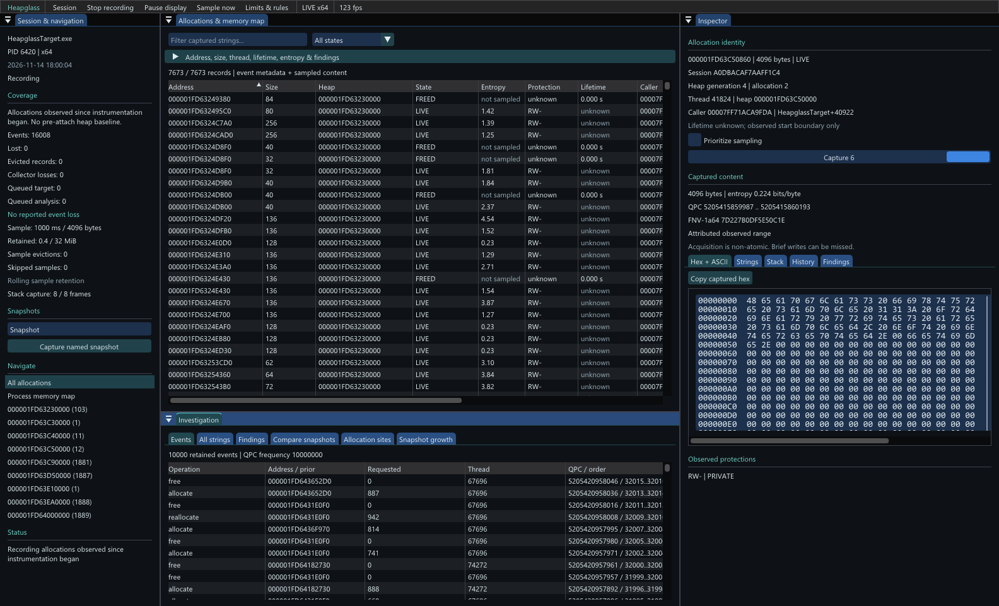

# Heapglass

Heapglass is a native Windows heap and memory inspector. It collects real Rtl heap events through an injected instrumentation DLL and samples process memory from a separate controller.



## Build and run

Use Windows 11 x64, Visual Studio 2022 or newer with Desktop development with C++, a Windows SDK, CMake 3.24 or newer, and Python 3 for dependency verification. All dependency source files are vendored and pinned. Builds do not download libraries.

```powershell
python scripts/verify-dependencies.py
cmake -S . -B build -A x64
cmake --build build --config Release --parallel
ctest --test-dir build -C Release --output-on-failure
.\build\bin\Release\Heapglass.exe
```

Keep `HeapglassAgent.dll` beside `Heapglass.exe`. The release build statically links the MSVC runtime. `scripts/build.ps1` performs the same checks.

## Inspect a process

1. Use **Session > Launch test target**, **Launch executable**, or **Attach to process**. Launch accepts arguments and a working directory.
2. Select an allocation to inspect captured hex, strings, size history, caller symbols, and findings. The string filter searches captured text.
3. Use **Sample now** or prioritize selected allocations. Configure sample budgets, retention mode, interval, string length, optional stack frames, and rule thresholds under **Limits & rules**. Rolling retention evicts the oldest captures at capacity. Stop-at-capacity mode skips new samples instead. The session panel reports evictions, skipped samples, queue backlogs, and event loss.
4. Capture named snapshots. Compare them in the bottom panel. Counts distinguish samples acquired during the snapshot interval from older retained captures.
5. Open the separate process memory map from the left panel. It reports committed private, mapped, and image regions, their protections, and available module and mapped-file associations.
6. Use **Save session / export JSON**, **Open saved session**, or **Export allocation CSV**. Raw sampled bytes are excluded by default. Enable **Include sampled bytes in JSON** to retain them. Extracted text remains in the JSON and may contain sensitive process data.
7. Open **Allocation sites** in the bottom panel to rank outstanding requested bytes by bounded stack or caller. Select a group to filter its allocations. Capture multiple snapshots and use **Snapshot growth** to compare counts, bytes, and surviving generations. Three clean observations can establish repeated growth as an investigation lead. Both reports support offline inspection and CSV exports. See [allocation sites and growth](docs/profiling.md).

**Stop recording** stops event production, while the target continues. **Pause display** freezes presentation while ingestion continues. **Disconnect** leaves the target operational. Installed hooks and their transport remain resident until target exit; disconnection does not unload the DLL.

## Coverage and limitations

The view contains allocations observed since instrumentation began, not a complete pre-attach heap baseline. Launch lets the process loader run before injection, so startup allocations can precede observation. The test target waits 1.2 seconds before its workload to permit a controlled launch test.

Only native x64 processes on x64 Windows are supported. Access checks, protected processes, signature policies, different-user sessions, or unavailable fixed TLS slots can prevent instrumentation. Heap hooks miss custom allocators that do not call the Rtl heap family. Virtual-memory protections are polled, and ordinary writes are sampled. Sampling is non-atomic and can miss brief changes.

A dedicated collector drains the target ring independently of sampling and analysis. The bounded queues still permit loss when full. Loss, allocation-record eviction, recording gaps, and overlapping operations produce explicit incomplete or uncertain state. Capture eviction removes historical samples without inventing allocation events. The larger queues increase controller memory use; see the measured tradeoff in the validation report.

ASCII, validated UTF-8, and UTF-16LE extraction retain exact byte offsets. Unicode candidates use Windows character classification and a limited supplementary repertoire. Installed CJK and emoji fonts extend display coverage, but the interface has no full RTL shaping. Optional stacks are disabled by default, capped at eight frames, and require an allocation-free unwinder probe.

Versions 0.2 and 0.3 use IPC protocol 2 and session format 2. They read format 1 sessions. Restart targets carrying a protocol 1 resident agent before attaching.

See [coverage and architecture](docs/coverage.md), [validation and measured performance](docs/validation.md), and [API references](docs/references.md). The tests and screenshots establish operation on the documented fixture, not detection of arbitrary malicious software.

## Validate and package

```powershell
.\build\bin\Release\HeapglassTests.exe --live
.\build\bin\Release\HeapglassTests.exe --benchmark > benchmark.json
.\build\bin\Release\Heapglass.exe --capture --profile
cmake --install build --config Release --prefix out/Heapglass
Compress-Archive -Path out/Heapglass/* -DestinationPath out/Heapglass-windows-x64.zip -Force
```

`--capture` runs the controlled target with eight stack frames, renders a hidden window without desktop input, exports allocation, memory-map, stack, allocation-site, and snapshot-growth PNGs beside the executable, and exits after about 24 seconds. It acquires three real snapshots during the run. The target continues until its 28-second workload finishes. `--profile` writes CPU draw-time and frame-time measurements on clean UI exit. `--test-target` opens the ordinary interface against a 180-second fixture.

Third-party license notices and exact source checksums are under `third_party` in the source checkout. The binary package retains license notices under `licenses`. The Win32/DX11 lifecycle adapts Dear ImGui's licensed example.
